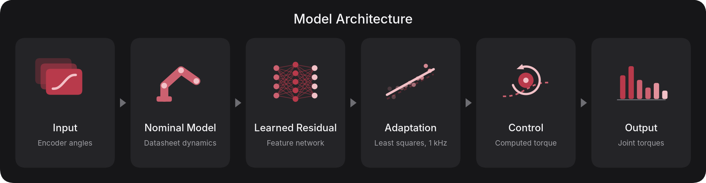
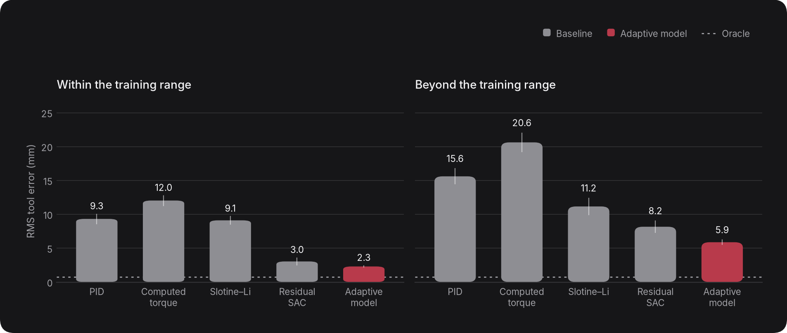
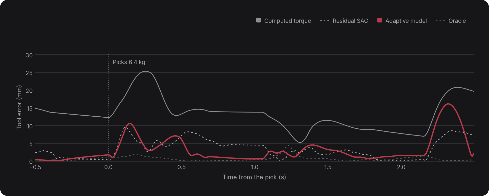
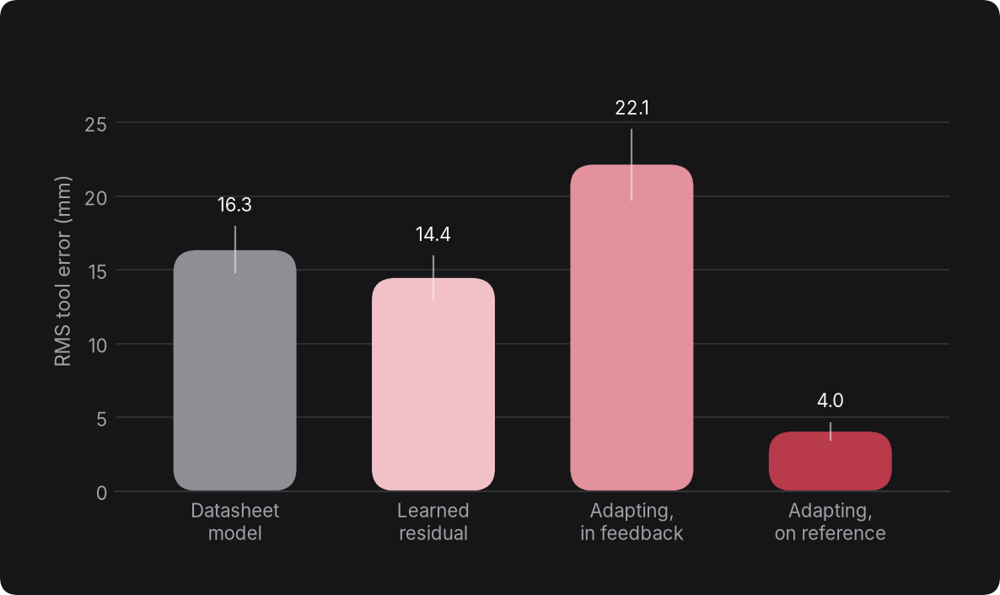
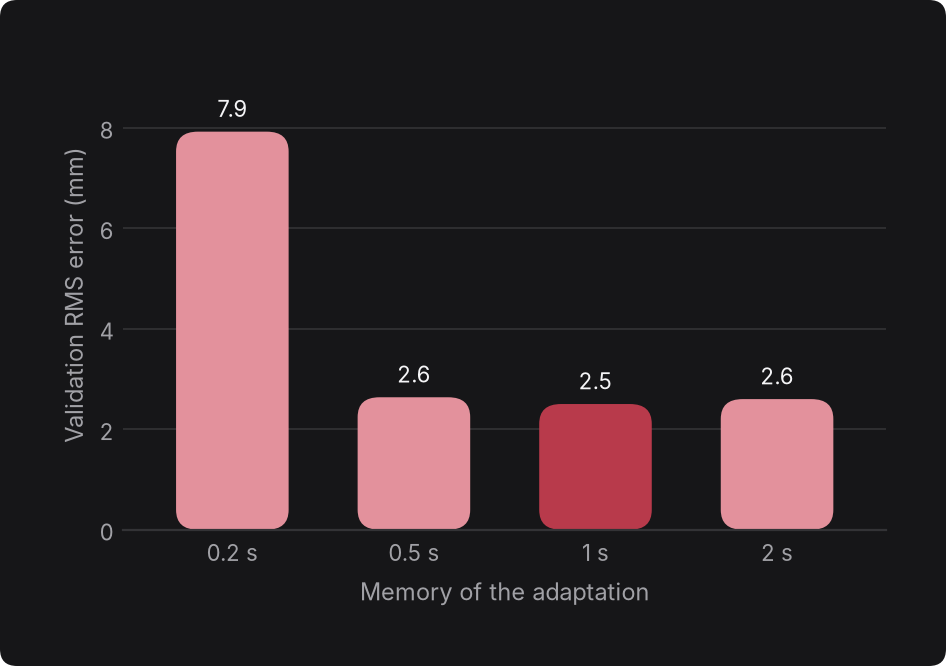

# Adaptive Motion Control


Adaptive Motion Control drives a cobot arm along its path while what it carries, how its joints rub and how strong its motors are keep changing. A controller tuned on the robot's datasheet loses accuracy as soon as the arm picks up a part, its joints warm up or its motors wear. This one keeps a small learned model of what the datasheet gets wrong, and updates that model a thousand times a second from the arm's own encoders. On a KUKA LBR iisy 8 in simulation, it holds the tool to 2.3 mm on average under changes like those it was trained on, against 9.3 mm for a PID controller. With payloads up to 8 kg and friction and wear beyond anything in its training, it holds 5.9 mm against 15.6 mm.

## How It Works



**Input.** The six joint angles from the encoders, read every millisecond at 19-bit resolution. Velocity and acceleration are estimated from them by finite differences and light filtering, as a servo drive would.

**Nominal model.** The arm as KUKA describes it, with the link masses, centres of mass and inertias KUKA publishes. MuJoCo's inverse dynamics turns a wanted acceleration into the joint torques it needs, so no equations of motion are written by hand. This model knows nothing about the payload, the friction in the gears or the state of the motors.

**Learned residual.** A small model maps the arm's state to 32 features, and a linear head turns them into the torque the nominal model misses on each joint. The model is trained offline on operating logs. Only the head changes in operation, so following the arm becomes a linear estimation problem with an exact answer.

**Adaptation.** Every millisecond, the torque that was applied and the acceleration it produced give a fresh measurement of the residual. Recursive least squares updates the head to fit it, with a forgetting factor that lets measurements older than about a second fade. The applied torque is delayed through the same filters as the acceleration estimate first, so the two describe the same moment.

**Control.** Computed torque on the nominal model, with feedback on the tracking error, plus the learned residual. The residual is evaluated on the reference path rather than on the measured state, so it acts as feedforward and stays out of the feedback loop.

**Output.** Six joint torques, within each motor's rated limit, a thousand times a second. One control step takes about 50 µs on a laptop CPU.

## How It Performs

The controllers are tested on 40 pick-and-place episodes, each of 16 moves between random points in the arm's workspace, with every joint kept under 70% of its rated speed. In each episode the payload changes at every pick and place, joint friction drifts as the joints warm up or cool down, and the motors lose torque. In 20 episodes these changes stay within the ranges of the training logs. In the other 20 they go beyond them, with payloads of 4 to 8 kg, friction from 0.4 to 1.6 times its base value and up to 30% of motor torque lost. None of these episodes, nor the 20 used to choose settings, appears in training. Every learned controller is trained five times on different data, and intervals are 95% hierarchical bootstrap intervals over seeds and episodes.

<p>
  
  <br>
  <sub><b>Tool error under changing conditions.</b> RMS distance between the tool and its reference position, within the training range (left) and beyond it (right), with 95% intervals. The dashed line is an oracle that is told the true payload, friction and wear, and shows what remains from sampling, sensing and feedback alone, 0.7 mm. The adaptive model reaches 2.3 mm within range and 5.9 mm beyond it. The residual SAC policy reaches 3.0 and 8.2 mm. PID, computed torque on the datasheet model and Slotine–Li adaptive control stay between 9 and 21 mm.</sub>
</p>

The baselines cover what is used in practice and what is commonly proposed instead.

- **PID** on each joint, with gravity compensation from the nominal model and gains set from each joint's inertia, the way a drive is commissioned. Its integral term absorbs steady offsets, which is why it beats computed torque on the datasheet model.
- **Computed torque** on the datasheet model, with the same feedback bandwidth as every model-based controller here, so they differ only in the model they use.
- **Slotine–Li adaptive control** of the payload mass, the classical answer to an unknown load. The payload enters the dynamics linearly, so its mass can be estimated online with stability guarantees. It cuts the error just after a pick by 40% but cannot reach friction or motor wear, which have no such known structure.
- **Residual SAC**, a policy trained by Soft Actor-Critic to add a torque correction on top of computed torque, from tracking errors and a short history of them. It sees the same changes during training and learns to correct for them from experience.

The adaptive model is ahead of SAC in 90% of seed and episode pairs, by 1.5 mm on average (interval 1.0 to 2.1 mm), and its five training seeds agree closely, from 3.96 to 4.27 mm, where SAC's range from 4.85 to 6.64 mm. SAC is slightly better in the half second just after a pick or place, 5.7 mm against 5.9 mm, because its correction reacts to the error at once, while the least-squares head needs a few hundred milliseconds of new measurements to move. The two also differ in what they need. The adaptive model learns from 14 minutes of logs recorded while the arm does its normal work. SAC needs 25 minutes of trial and error on the arm and 19 minutes of training per seed, and its corrections are explored rather than recorded.

<p>
  
  <br>
  <sub><b>Through a pick.</b> Tool error from half a second before to 2.5 seconds after the arm picks up a 6.4 kg part, beyond the training range, on one test episode. Computed torque on the datasheet model jumps to 25 mm and settles near 14 mm, because it never learns about the part. The adaptive model's error rises to 11 mm while its head has seen only a few measurements of the new load, and falls below 2 mm within 0.6 s. The part is placed at 1.05 s and picked again at 2.15 s. With a memory of about a second, the head has mostly forgotten the load by then, and catches up with it again.</sub>
</p>

## How Each Part Contributes

Each part was added in turn, on the first training seed, and the 40 test episodes were run again.

<p>
  
  <br>
  <sub><b>What each part adds.</b> RMS tool error on all 40 test episodes, with 95% intervals. The datasheet model alone gives 16.3 mm. The learned residual with its fixed prior head gives 14.4 mm. Adapting the head while evaluating the residual on the measured state makes the arm worse, 22.1 mm. Adapting it while evaluating the residual on the reference path gives 4.0 mm.</sub>
</p>

- **The learned residual alone.** Without adaptation, the prior head can only predict what is common to every condition in the logs. It removes 2 mm.
- **Adaptation in the feedback loop.** Evaluated on the measured state, the adapting model sits inside the feedback loop. An error in its estimate moves the arm, the movement changes the next measurement, and the two feed each other, so the error grows rather than shrinks. This was the first version built.
- **Adaptation on the reference.** Evaluated on the reference path, the residual becomes pure feedforward (desired compensation, Sadegh and Horowitz, 1990). Feedback alone corrects what is left, and the loop cannot feed on the model's own errors. The error falls fourfold.

<p>
  
  <br>
  <sub><b>How long to remember.</b> RMS tool error on the 20 validation episodes for each forgetting factor, shown as the time over which old measurements fade at 1 kHz. A memory of 0.2 s follows the arm quickly but chases noise, 7.9 mm. From 0.5 s to 2 s the error stays near 2.5 mm, and 1 s is the lowest.</sub>
</p>

## How It Was Trained

The logs come from the arm doing pick-and-place under computed torque on the datasheet model, the controller a cell would already run, with payloads from 0 to 4 kg, friction from 0.7 to 1.3 times its base value and up to 15% of motor torque lost. Each record holds the state before a control step, the acceleration measured after it and the residual torque the nominal model did not explain, computed exactly as the controller computes it online. Records are kept at 200 Hz, 167,429 of them for the first seed.

| Seed 0 | Episodes | Operating time |
| :-- | --: | --: |
| Training | 35 | 12 min |
| Held out | 5 | 2 min |

Training mimics deployment. The logs are cut into windows of half a second. In each window the head is fitted in closed form to the first 0.3 s, starting from a learned prior head, which is what recursive least squares does from its prior, and the model is scored on how well that head predicts the next 0.2 s. The prior head, and how strongly the fit holds to it, are learned at the same time and become the starting point of adaptation. Each joint's residual is divided by its spread, so the base joints, whose torques are a hundred times the wrist's, do not dominate. After 40 epochs the held-out error after adapting is 0.18, against 0.99 for the prior head alone. The model is exported to ONNX and matches PyTorch to 2 × 10⁻⁶.

The forgetting factor, 0.999, and the Slotine–Li adaptation rate, 80, are chosen on the 20 validation episodes, never on the test episodes. The Slotine–Li rate sits at the top of the range tried, where its error had levelled off between 20 and 80.

## How to Use It

The model is released in `models/` as `dynamics.onnx` (34 KB) and `head.npy`, with the controller in `src/` and KUKA's robot description in `assets/lbr-iisy/`. Running it needs NumPy, MuJoCo and ONNX Runtime. The model card, `models/model.json`, records the training data, settings and results.

### Installation

```bash
git clone https://github.com/iamabdirazak/adaptive-motion-control.git
cd adaptive-motion-control
python3 -m venv .venv && source .venv/bin/activate
pip install numpy "mujoco>=3.11,<4" onnxruntime matplotlib pytest
python -m pytest -q
```

### Controlling an Arm

```python
import numpy as np
from src.paths import MODELS, ROBOT
from src.plant.sensing import Sensing
from src.system import adaptive_controller

controller = adaptive_controller(ROBOT, MODELS)   # the robot's description and the released model
sensing = Sensing(joints=6, period=0.001)
controller.reset()
torque = np.zeros(6)

while running:                                     # every millisecond
    measured = sensing.read(encoder_angles())      # angles in, velocity and acceleration estimated
    controller.learn(measured, torque)             # adapt to what the last torque did
    torque = controller(reference(), measured)     # a Reference: angle, velocity, acceleration
    send(torque)                                   # N·m per joint
```

### Reproducing the Results

```bash
pip install torch onnx onnxscript "gymnasium>=1.3,<2" stable-baselines3     # needed for training only
mkdir -p runs
for s in 0 1 2 3 4; do (python -m src.training.collect --seed $s --episodes 40 && python -m src.training.fit --seed $s && python -m src.training.export --seed $s) & done; wait
python -m src.training.export --seed 0 --release
python -m src.evaluation.tune --seeds 2
for s in 0 1 2 3 4; do python -m src.training.rl --seed $s > runs/sac-$s.log 2>&1 & done; wait
python -m src.evaluation.study pid computed-torque slotine-li oracle learned-fixed learned-adaptive residual-sac --bank test --seeds 5
python -m src.evaluation.study learned-feedback --bank test --seeds 1
python -m src.evaluation.trace
python -m src.visualization.results && python -m src.visualization.diagrams
```

Everything runs on a CPU. The whole study takes about half an hour on a laptop, most of it training the SAC baseline.

## Limitations

- Tested in simulation only. The arm, its sensing and its changes are modelled, and the friction values are typical harmonic-drive values, since KUKA does not publish friction.
- The payload is a point mass at the flange. A long or offset part would add inertia the residual has to learn.
- Each pick changes the load in one step, and the head needs a few hundred milliseconds to follow, which is where most of the remaining error sits.
- The arm moves in free space. Contact with parts or fixtures is not modelled.
- Times are measured on a laptop CPU, not on a robot controller.

## License

The code is released under the MIT License. The robot description in `assets/lbr-iisy/` is KUKA's, from [kuka_robot_descriptions](https://github.com/kroshu/kuka_robot_descriptions), under the Apache License 2.0, with its notice kept alongside it.

## Author

Abdirazak Mubarak, November 2026
